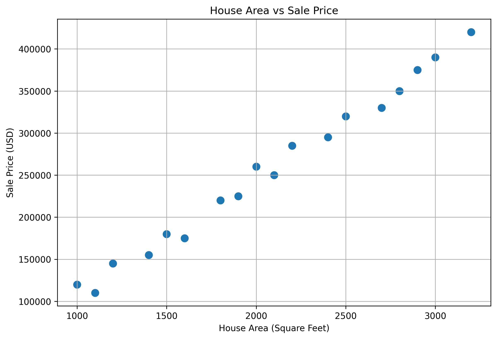
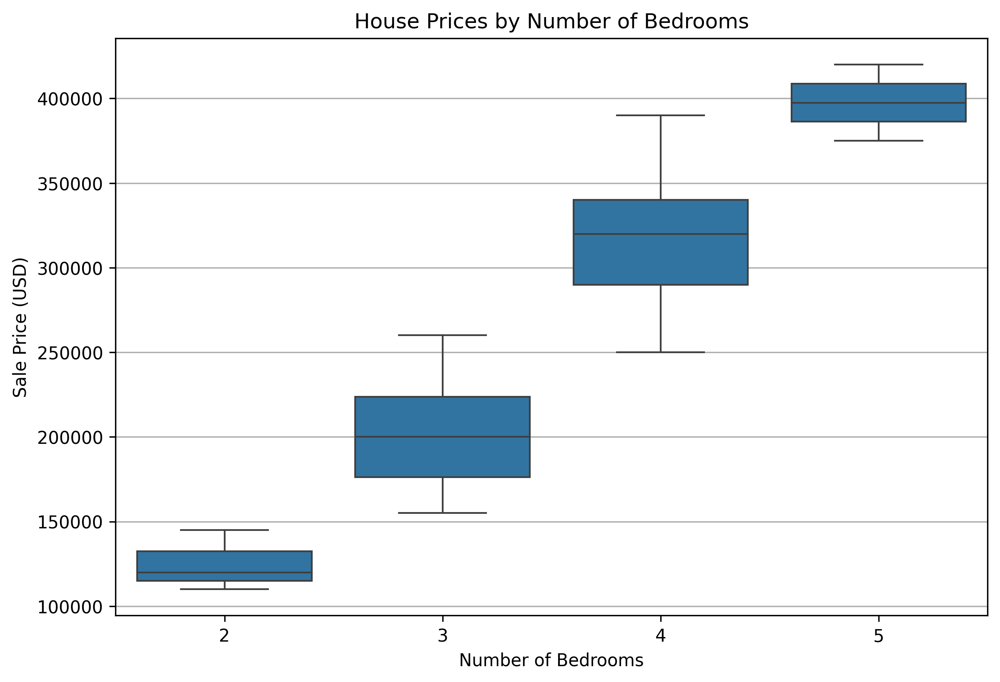
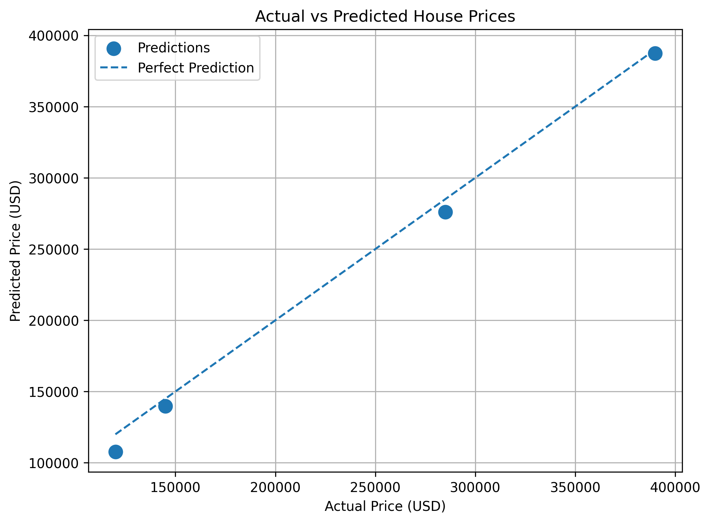
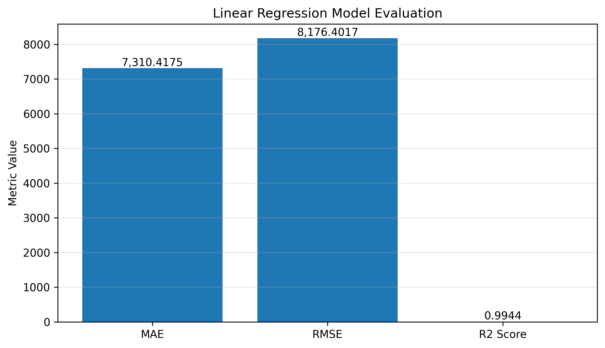
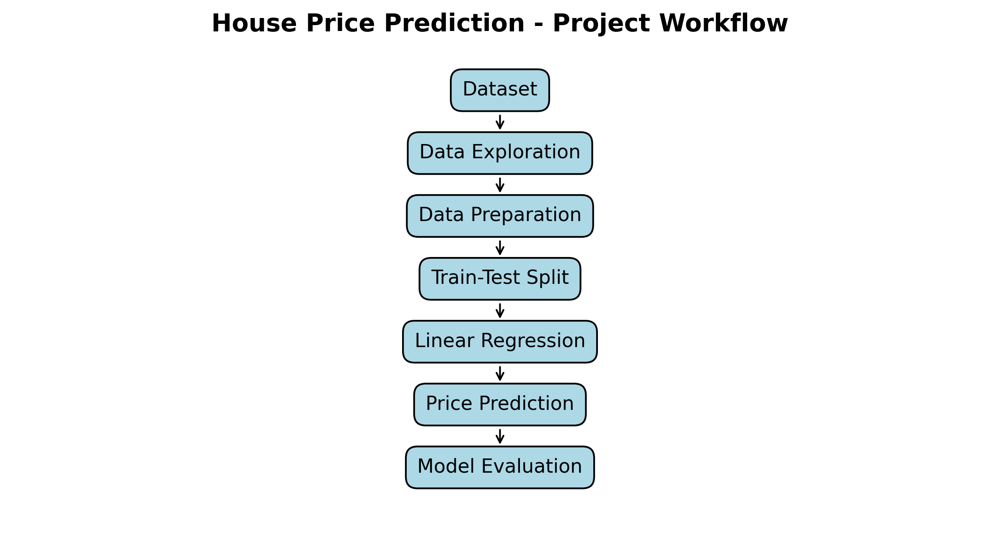

 House Price Prediction using Machine Learning

 1. About the Project

This project is about predicting house prices using Python and Machine Learning.

I built a Linear Regression model that estimates a house's price using four details:

- Area of the house
- Number of bedrooms
- Number of bathrooms
- Age of the house

The project starts with a small sample dataset. I used Pandas to work with the data, Matplotlib and Seaborn to create charts, and Scikit-learn to train and evaluate the model.

The main purpose is to understand how house price prediction works, from preparing the data to checking the model's predictions.

 2. Problem Description

House prices can vary depending on different property features. For example, a larger house may have a higher price, while the age and number of rooms can also affect its value.

The goal of this project is to use these details as input and estimate a possible selling price.

This is a regression problem because the model predicts a numerical value rather than a category.

 3. Project Goals

The main things I worked on in this project are:

- Creating and exploring a house price dataset.
- Understanding the relationship between property features and prices.
- Visualizing the data through charts.
- Preparing input features and the target variable.
- Splitting the data into training and testing sets.
- Training a Linear Regression model.
- Comparing actual prices with predicted prices.
- Evaluating the model using standard regression metrics.

 4. Dataset

For the initial version, I created a sample dataset containing 18 house records.

The dataset is used to practise the complete Machine Learning workflow. Its prices are sample USD values and do not represent actual property transactions or current market prices.

 Dataset columns

| Column | Description |
|---|---|
| `Area_sqft` | Total house area in square feet |
| `Bedrooms` | Number of bedrooms |
| `Bathrooms` | Number of bathrooms |
| `House_Age` | Age of the house in years |
| `SalePrice` | Sample selling price in USD |

 Example data

| Area_sqft | Bedrooms | Bathrooms | House_Age | SalePrice |
|---:|---:|---:|---:|---:|
| 1000 | 2 | 1 | 5 | $120,000 |
| 1500 | 3 | 2 | 6 | $180,000 |
| 2000 | 3 | 3 | 2 | $260,000 |
| 2500 | 4 | 3 | 4 | $320,000 |
| 3000 | 4 | 4 | 2 | $390,000 |

The complete sample dataset is created in the project notebook.

 5. Exploratory Data Analysis

Before training the model, I explored the dataset to understand how its values are related.

I created charts to look at house prices from different perspectives.

 Area vs. Sale Price

This scatter plot compares house area with selling price.

It helps show how prices change as the size of a house increases. In this sample dataset, larger houses generally have higher prices.

 Bedrooms vs. Sale Price

This box plot compares selling prices across different bedroom counts.

It helps show the distribution of prices for houses with different numbers of bedrooms.

 6. Data Preparation

The dataset contains four input features and one target column.

The input features are:

- `Area_sqft`
- `Bedrooms`
- `Bathrooms`
- `House_Age`

The target variable is `SalePrice`, which is the value the model needs to predict.

I separated the input features (`X`) from the target (`y`) before training the model.

The data was then divided into two parts:

- Training data:** Used to train the model.
- Testing data:** Used to check predictions on data not used during training.

I used an 80/20 train-test split with `random_state=42`.

 7. Machine Learning Model

 Linear Regression

I used Linear Regression from Scikit-learn.

Linear Regression is a supervised Machine Learning algorithm. It learns the relationship between input features and a numerical target value.

In this project, it uses house area, bedrooms, bathrooms, and house age to estimate the selling price.

The model was trained using the training portion of the dataset. After training, I used the testing data to generate price predictions.

 8. Prediction Results

After training, I compared the model's predicted prices with the actual prices in the test set.

I also created an Actual vs Predicted chart.

In this chart:

- The horizontal axis represents actual house prices.
- The vertical axis represents predicted house prices.
- The dashed line represents a perfect prediction.

Points closer to the dashed line indicate predictions closer to the actual values.

 9. Model Evaluation

I used three regression metrics to evaluate the model.

| Metric | Result |
|---|---:|
| MAE | $7,310.42 |
| RMSE | $8,176.40 |
| R² Score | 0.9944 |

 What do these metrics mean?

Mean Absolute Error (MAE)**

MAE calculates the average absolute difference between actual and predicted prices. In this run, the average absolute error was approximately $7,310.42.

Root Mean Squared Error (RMSE)**

RMSE measures prediction error while giving larger errors more weight. The result in this run was approximately $8,176.40.

R² Score**

R² indicates how well the model's predictions fit the target values in the test data. The score in this run was 0.9944.

Important:** These results come from a very small synthetic dataset. Only four records were used for testing. A high R² score on this sample does not mean the model will achieve the same performance on real house prices.

 10. Technologies Used

| Technology | Purpose |
|---|---|
| Python | Main programming language |
| Pandas | Creating and handling the dataset |
| NumPy | Numerical operations |
| Matplotlib | Creating charts |
| Seaborn | Data visualization |
| Scikit-learn | Training and evaluating the model |
| Google Colab | Writing and running the notebook |
| GitHub | Storing and documenting the project |

 11. Project Structure

The repository is organized into folders for different parts of the project.

```text
House-Price-Prediction-ML/
│
├── data/
│   └── Dataset files
│
├── notebooks/
│   └── Jupyter notebook
│
├── src/
│   └── Python source files
│
├── app/
│   └── Application files
│
├── images/
│   └── Project charts
│
├── README.md
├── LICENSE
└── .gitignore
```

The folders are intended to keep datasets, notebooks, source code, application files, and charts separate. The actual files will be added as those parts of the project are developed.

 12. How to Run the Project

The notebook can be opened and executed using Google Colab.

1. Open the notebook from the `notebooks` folder once it has been uploaded.
2. Open it in Google Colab.
3. Run the cells from top to bottom.
4. The notebook creates the sample dataset, explores the data, trains the model, and displays the evaluation results.

 Required libraries

The project uses these Python libraries:

```bash
pip install pandas numpy matplotlib seaborn scikit-learn
```

 13. Current Limitations

There are a few limitations in the current version:

- The dataset contains only 18 sample records.
- The prices are synthetic and are not taken from actual property sales.
- The testing set contains only four records.
- The model has not yet been tested on a larger real-world dataset.
- The current version does not include a web application.

These limitations are important when interpreting the model's results.

 14. Future Improvements

I plan to improve the project by:

- Working with a larger real-world house price dataset.
- Adding more data analysis and visualizations.
- Testing additional Machine Learning models.
- Improving data preprocessing and model evaluation.
- Building a simple web interface for price predictions.

 15. License

This project is available under the MIT License. See the `LICENSE` file for details.

 Project Visuals

 1. Dataset Preview


 2. Area vs Sale Price


 3. Bedrooms vs Sale Price


 4. Actual vs Predicted Prices


 5. Model Evaluation


 6. Project Workflow

